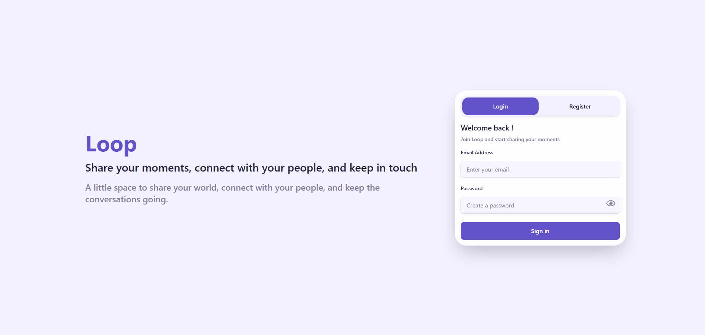
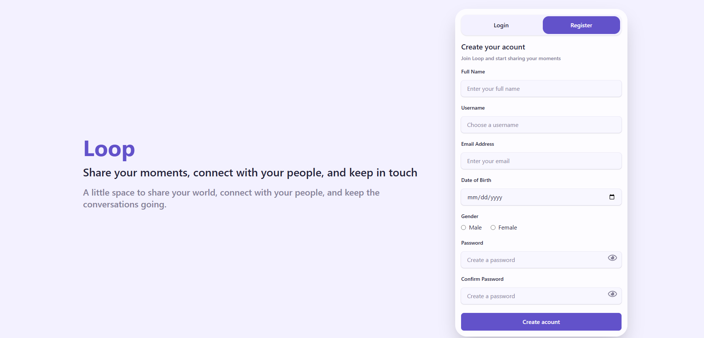
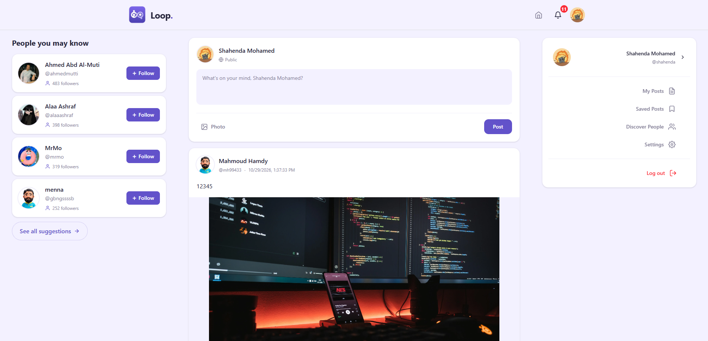
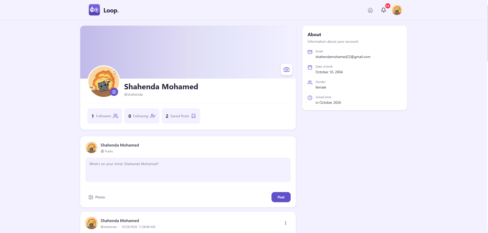
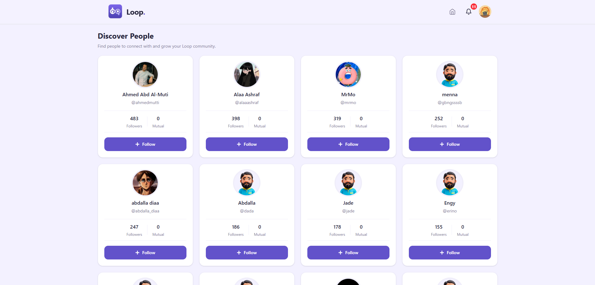
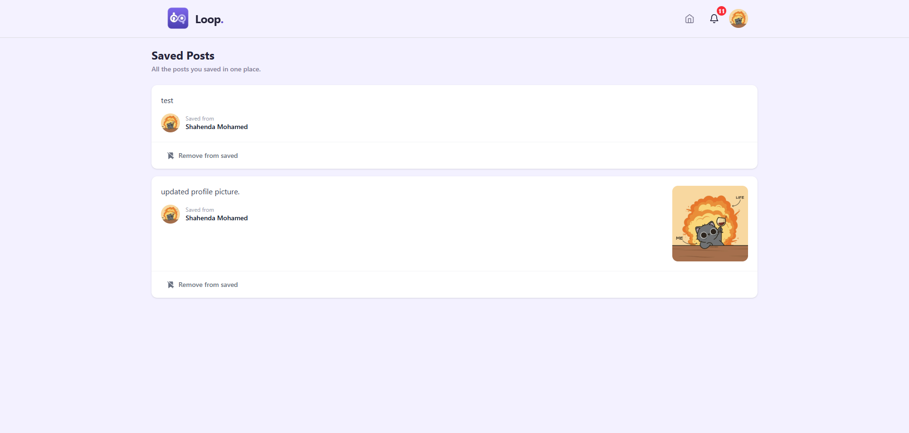
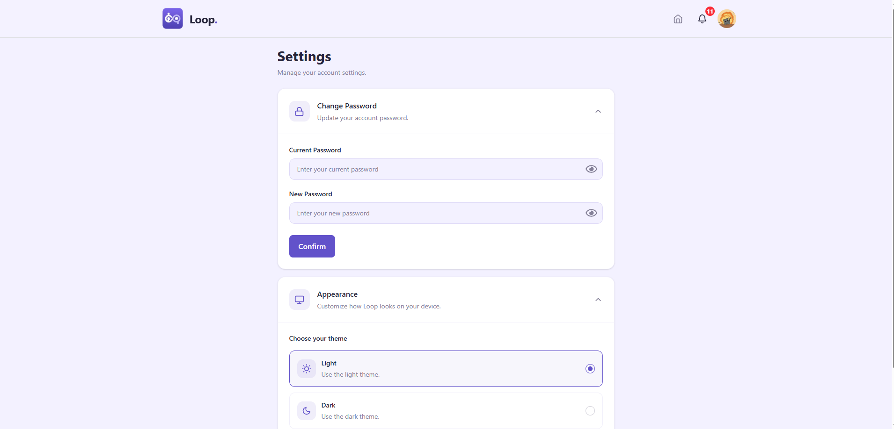

<div align="center">

# Loop

**Your people. Your moments.**

A responsive social media web app where people share posts, follow each other and
interact through likes, comments, replies and notifications.

[Live Demo](https://loop-liard-nine.vercel.app/) 


</div>

---

## About the Project

Loop is a single-page social app built with **React 19** and **TypeScript**, Users can create an account, publish
posts with images, react to other people's content, follow friends, and customize the app's
appearance (light, dark or system theme).


---

## Screenshots

### Authentication

| Login | Register |
| :---: | :---: |
|  |  |

### Home Feed




### Profile & Social

  

| Discover people | Saved posts |
| :---: | :---: |
|  |  |

### Settings & Themes

  

---

## Features

**Authentication**
- Sign up and sign in with validated forms (React Hook Form + Zod).
- Protected routes: visitors without a session are redirected to the login page.
- Change your password from the settings page.

**Posts**
- Create, edit and delete your own posts, with optional image upload.
- Share another user's post with your own caption.
- Like / unlike a post and see the list of people who liked it.
- Bookmark posts and manage them from the Saved Posts page.

**Comments**
- Comment on a post, reply to comments, and like comments.
- Edit and delete your own comments (with image support).

**Social**
- Follow / unfollow users and browse followers and following lists.
- Discover people through suggestions.
- View your own profile or other users' profiles with their posts.
- Update your profile photo.

**Notifications**
- Unread counter in the navbar and a dedicated notifications page.
- Mark a single notification, or all of them, as read.

**Experience**
- Fully responsive layout with a mobile menu.
- Light, dark and system themes, saved between visits.
- Loading skeletons, toast messages and clear form errors.

---

## Tech Stack

| Area | Tools |
| --- | --- |
| UI | React 19, TypeScript, Vite |
| Styling | Tailwind CSS 4, HeroUI |
| Server state | TanStack Query (React Query) |
| Forms & validation | React Hook Form, Zod |
| Routing | React Router 7 |
| HTTP | Axios |
| Icons | React Icons |
| Deployment | Vercel |

---

## Getting Started

### Prerequisites

- [Node.js](https://nodejs.org/) 20.19+ or 22.12+ (required by Vite 8)
- npm

### Installation

```bash
# 1. Clone the repository
git clone https://github.com/shahendamohamed22/social-app.git

# 2. Go to the project folder
cd social-app

# 3. Install dependencies
npm install

# 4. Start the development server
npm run dev
```

The app will be available at `http://localhost:5173`.

The API base URL lives in `src/shared/api/baseURL.ts`.

---

## Available Scripts

| Command | What it does |
| --- | --- |
| `npm run dev` | Starts the development server with hot reload |
| `npm run build` | Type-checks with `tsc` and creates a production build in `dist/` |
| `npm run lint` | Runs ESLint on the project |
| `npm run preview` | Serves the production build locally |

---

## Project Structure

```
src/
├── components/        Reusable UI (cards, comments, navbar, modals ...)
├── layouts/           Main layout and auth layout
├── pages/             One folder per route
│   ├── Auth/              Login & Register
│   ├── Home/              Feed, sidebar, suggestions
│   ├── PostDetails/
│   ├── Profile/
│   ├── FollowersAndFollowing/
│   ├── AllSuggestions/
│   ├── Saved/
│   ├── Notifications/
│   ├── Settings/
│   └── notFound/
├── interfaces/        TypeScript types
├── validation/        Zod schemas for the forms
├── defaultValues/     Default values for the forms
└── shared/
    ├── api/               Axios instance
    ├── context/           Auth, profile, notifications and theme providers
    ├── Guards/            ProtectedRoute
    ├── Hooks/             Data-fetching and mutation hooks, grouped by feature
    ├── routing/           Route definitions
    └── style/             Global styles and theme tokens
```

---

## How It Works

- **Authentication:** the token is saved in `localStorage` and the Axios instance sends it as a
  `Bearer` header on every request.
- **Server state:** every request goes through React Query hooks. Queries that need a logged-in
  user wait for the token before running.
- **Cache refresh:** mutations (like, comment, follow ...) invalidate the related queries from one
  place (`useInvalidateQueries`), so the UI updates after every change.
- **Theming:** colors are CSS variables. The `.dark` class swaps their values, so components
  never need separate dark styles.

---

## Deployment

The project is deployed on [Vercel](https://vercel.com/). The `vercel.json` file rewrites every
route to `index.html`, so refreshing a page that uses React Router does not return a 404.

To deploy your own copy: import the repository in Vercel, keep the default Vite settings
(build command `npm run build`, output directory `dist`) and deploy.

---

## Author

**Shahenda Mohamed**

- GitHub: [@shahendamohamed22](https://github.com/shahendamohamed22)

- LinkedIn: [profile](https://www.linkedin.com/in/shahenda-mohamed1/)

---

